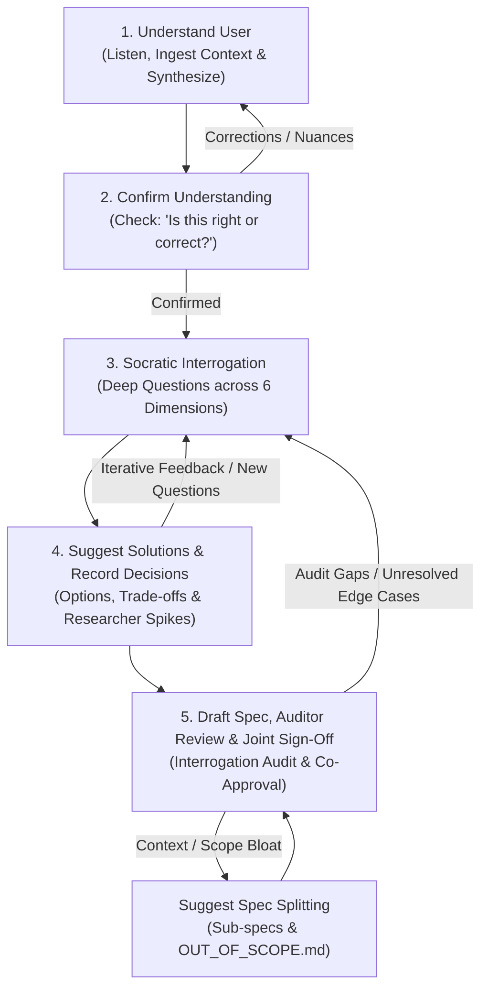

# Workflow 01: Spec Authoring & Decision Logging (Developer Zone)

## Objective
Collaboratively define clear, concise, unambiguous high-level specifications with the human developer through interactive dialogue, without introducing premature implementation code or unilateral assumptions.

---

## Operating Principles in the Developer Zone
1. **Spec Quality Governs the Factory**: If the specification is clear and concise, downstream planning, execution, and verification run deterministically.
2. **Zero Assumptions**: The agent never unilaterally chooses architectures, schemas, or behaviors, and never assumes missing requirements.
3. **Patience & Time-Rich Collaboration**: Spec definition is thorough; sessions can take an hour or more of interactive chatting. Never rush.
4. **Split-Spec Vigilance**: If context becomes large or scope spans multiple decoupled features, proactively suggest splitting the spec into modular sub-specs.

---

## Step-by-Step Flow (The 5-Phase Loop)

---

### Step 1: Understand User (Listen & Synthesize)
- Greet the human developer as **Spectre** (`.gb-sdlc/agents/spectre.md`).
- Read `HANDOFF.md`, `TODO.md`, and relevant architecture docs to ground project context.
- Check `TODO.md` for existing candidate Proto-Specs and suggest graduating any relevant items.
- Ingest the user's intent, raw ideas, problem statements, and desired outcomes.
- Synthesize the core problem, target audience, and business intent. Do NOT jump to solutions or code yet.

---

### Step 2: Confirm Understanding Checkpoint
- Explicitly reflect the synthesis back to the human developer:
  > *"Here is my understanding of what you want to achieve: [Core Goal, Target Persona, Expected Outcome]. Did I capture this accurately? Did I miss or misinterpret anything?"*
- Wait for human validation.
- If the developer provides corrections, refine the synthesis and re-confirm until mutual alignment is locked in.

---

### Step 3: Socratic Interrogation (Deep Questioning)
- Systematically interrogate the problem space across 6 critical dimensions:
  1. **Boundaries & Scope**: What is strictly IN scope? What is explicitly OUT of scope?
  2. **Actors & Permissions**: Who uses this? What authentication, authorization, or role checks are required?
  3. **Data Entities & State Transitions**: What models exist? What are the allowed state lifecycles and mutations?
  4. **Edge Cases & Failure Modes**: What happens when the network fails, timeouts occur, invalid input arrives, or concurrency conflicts occur?
  5. **Non-Functional Requirements**: Latency, throughput, scalability, data retention, rate limits, security compliance.
  6. **User Journey & Experience**: What is the happy path? How are error conditions surfaced to users?
- Ask questions in focused, digestible batches (2–4 at a time). Never guess answers.

---

### Step 4: Suggest Solutions & Record Decisions
- Propose 2–3 viable architectural or behavioral solutions with clear trade-offs evaluated in **gb-sdlc priority order**:
  1. **Security (Priority #1)**
  2. **Low Technical Debt (Priority #2)**
  3. **Speed & Simplicity (Priority #3)**
- **Technical Spikes & Live Web Search (Researcher)**:
  - When exploring modern libraries, APIs, or 2026 best practices, delegate to or invoke **Researcher** (`.gb-sdlc/agents/researcher.md`).
  - Researcher performs live web searches and documents findings in `docs/researches/<YYYY-MM-DD>-<topic>.md` using `.gb-sdlc/templates/research.md`.
  - Link the research spike in the spec.
- **Decision Capture**:
  - For every architectural choice made by the human, create `docs/decisions/DXX.md` and hyperlink it in the spec.
- **Back-and-Forth Iteration**: If solution discussions uncover new questions or trade-offs, loop back to Step 2 or Step 3 as needed.

---

### Step 5: Draft Spec, Split-Check, Spectre Auditor Review & Joint Sign-Off (Formal Spec Gate)
- Draft the specification in `docs/specs/<spec-name>.md` using `.gb-sdlc/templates/spec.md`:
  - Problem intent & overview.
  - Linked Research spikes (`docs/researches/`).
  - Linked Human Decisions (`docs/decisions/`).
  - Behavioral requirements in **EARS** syntax (Ubiquitous, Event-driven, State-driven, Unwanted behavior).
  - Concrete GIVEN-WHEN-THEN acceptance criteria.
  - Scope boundaries (In Scope vs. Out of Scope).
- **Mandatory Split-Spec Check**:
  - If the conversation or scope is becoming large or spans multiple subsystems:
  - Proactively suggest splitting the spec into modular child specs (e.g. `SPEC-001a` and `SPEC-001b`) and offloading secondary features to `docs/specs/OUT_OF_SCOPE.md` or candidate proto-specs in `TODO.md`.
- **Mandatory Prompt Before Approval (Spectre as Co-Auditor)**:
  - When the spec draft is presented and the human developer indicates readiness to approve or sign off:
  - **The agent MUST explicitly prompt the developer**:
    > *"Before this specification can be approved or signed off, Spectre must conduct an Auditor Review and Interrogation of the spec first. In gb-sdlc, Spectre acts as the dedicated auditor alongside you—the spec cannot be approved or signed off until Spectre verifies zero assumptions, stress-tests edge cases, validates strict EARS compliance, checks scope boundaries, and confirms security principles. Let's run the audit now."*
- **Spectre Auditor Review & Socratic Interrogation Audit**:
  - Spectre rigorously audits the draft against the 6 core dimensions:
    1. **Zero Assumptions**: Are all architectural choices backed by human decisions in `docs/decisions/`?
    2. **Deep Socratic Interrogation & Edge Cases**: Are network disconnects, timeouts, race conditions, invalid inputs, and error states thoroughly probed and resolved?
    3. **EARS Syntax**: Are all requirements strictly formatted in EARS statements?
    4. **Acceptance Testability**: Concrete GIVEN-WHEN-THEN scenarios with zero hand-wavy claims.
    5. **Scope Watchdog**: Spec is compact; excess complexity deferred to `OUT_OF_SCOPE.md` / `TODO.md`.
    6. **Security & OWASP Pre-Check**: Priority #1 Security rules verified.
  - If any gaps exist, Spectre interrogates the developer to resolve them before proceeding.
  - Once audit passes: Record `spectre_audit: PASSED` in frontmatter and Section 7 checklist.
- **Joint Co-Sign-Off (`status: APPROVED`)**:
  - Present the audited, certified spec to the human developer.
  - Obtain explicit human sign-off (`status: APPROVED`).
  - The spec is signed off ONLY when both Spectre audit has `PASSED` and the human developer approves.
- **Session Continuity Update**:
  - Update `HANDOFF.md` with active spec, status set to `PLANNING`, and immediate next step pointing to **Planner** for Workflow 02 (`02-planning-battleground.md`).
