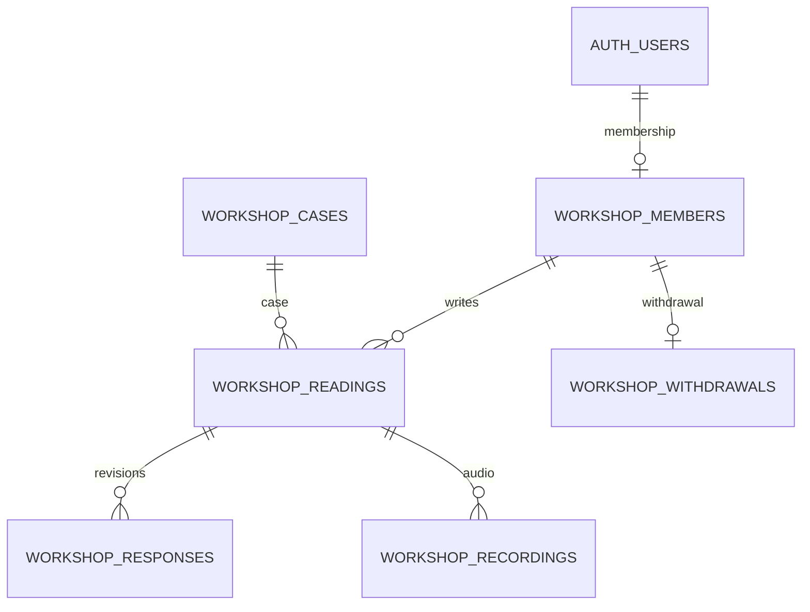

# 04 · Data and payments

## Existing tables (workshop, legacy)

Canonical schema: [`reference/workshop-migrations/001_workshop.sql`](../reference/workshop-migrations/001_workshop.sql), then 002 and 003. Case questions and cards live in the workshop app's `lib/cases.json`; `workshop_cases` stores ID / version / split for integrity checks.

| Table | Purpose / relations |
|---|---|
| `auth.users` | Supabase Auth; referenced by `workshop_members.user_id` |
| `workshop_members` | active flag, role `owner` / `reader`; membership added after a successful login |
| `workshop_cases` | ID, version, `development` / `holdout` |
| `workshop_readings` | one current draft per `(reader_id, case_id)`; revision, stage, baseline/follow-up JSON |
| `workshop_responses` | revision history, consent, request; FK to reading; unique `(reader, case, revision)` |
| `workshop_recordings` | audio metadata: object key, type, size, duration, pending/ready; FK to reading |
| `workshop_withdrawals` | consent withdrawal requests and when they were handled; FK to member |

- `workshop-audio`: private bucket for audio.
- `workshop-review`: separate private bucket for the `/review` page's manifest, source and immutable revision JSON (not a SQL table).
- The server checks the owner role before using the privileged storage client. RLS blocks direct reads, but service-role code must still check permissions every time.
- Workflow `baseline → followup → review` means "submitted for review". Approval in `/review` is a separate workflow. Neither equals a published knowledge release.

## Proposed tables for the real product (no migration yet)

| Group | Proposed tables | Requirements |
|---|---|---|
| Accounts / roles | `profiles`, `organization_members` | Separate customer / editor / reviewer / admin. Workshop `owner` does not automatically get every permission. |
| Reader knowledge | `knowledge_entries`, `knowledge_releases`, `style_versions`, `approval_events` | Source ID, version, scope, approver, time. Draft / approved / published kept separate. |
| Readings | `reading_sessions`, `reading_cards`, `reading_outputs` | Category, intent, question, time horizon; cards, positions, 4th card; engine and knowledge versions; evidence IDs. |
| Payments | `orders`, `payment_events`, `credit_ledger`, `credit_reservations` | Money as integer satang; unique provider event; immutable ledger; transactions prevent double charge / double spend. |
| Content | `content_projects`, `episodes`, `scripts`, `assets`, `generation_jobs`, `job_attempts`, `cost_ledger`, `review_events` | Versions, asset provenance, queue state, provider ID, estimated vs actual cost, approval. |
| Tracking | `audit_events`, `outbox_events` | Actor, version, time, event. Logs do not store raw questions, audio or secrets unless needed. |

This is a logical model for review. A fuller earlier proposal (accounts with LINE/Google login, siamsi, bookings, journal/community, themes, competitor social data) is in [`reference/schema-proposal-v0.1.dbml`](../reference/schema-proposal-v0.1.dbml). It was never migrated; treat it as ideas, not as the schema.

## Pricing (proposal, not on sale)

- Start with one-time **credit packs, one credit per question**, before subscriptions.
- One question = past / present / future + the 4th future card. Clarifying follow-ups must not silently count as a new question.
- The free daily reading is the entry point.
- Owner ideas, **not launched**: 69 THB / 1 question, 99 THB / 3 questions, 199 THB / week, 399 THB / month. Unlimited plans need agreed scope, fair use and heavy-user cost first.
- Provider not chosen. Check merchant onboarding, supported payment methods for a Thai business (PromptPay, TrueMoney, cards), current fees and refunds. No integration exists.

## Payment flow required before taking real money

1. The server creates the order from SKU and price in the database. Never trust price or credit amount from the browser.
2. Open hosted checkout with the order ID and an idempotency key.
3. The webhook verifies the signature on the raw body, stores `provider_event_id` as unique, then updates the order and adds to the ledger **in one transaction**. Landing on the success page alone adds nothing.
4. Duplicate purchases or webhooks add credit once. Handle out-of-order events and confirm payment state with the provider when needed.
5. When a paid question starts, the server reserves a credit and locks the reading and card draw. A request ID makes retries return the same session; reloading never redraws or charges again.
6. When the reading succeeds, commit the credit together with the output. If a clarifying question is needed, keep the session per the agreed rules. On failure, release the reservation with an auditable entry.
7. A reconciliation job handles paid-but-not-credited, stuck jobs, refunds, chargebacks and negative balances per policy.

Minimum tests: webhook replay and out-of-order, checkout closed midway, two tabs at once, worker crash, provider timeout, refund after credit use, retry after failure without double charge. See [Stripe webhooks](https://docs.stripe.com/webhooks) as a pattern; follow the chosen provider's docs.

## Data boundaries

- Separate dev / staging / prod. Never copy real answers or audio to dev machines; use synthetic fixtures.
- Backup must cover DB, Auth and Storage, with a tested restore. The old workshop JSON export is not disaster recovery.
- Personal data stays out of logs and out of third-party services unless needed and agreed.
